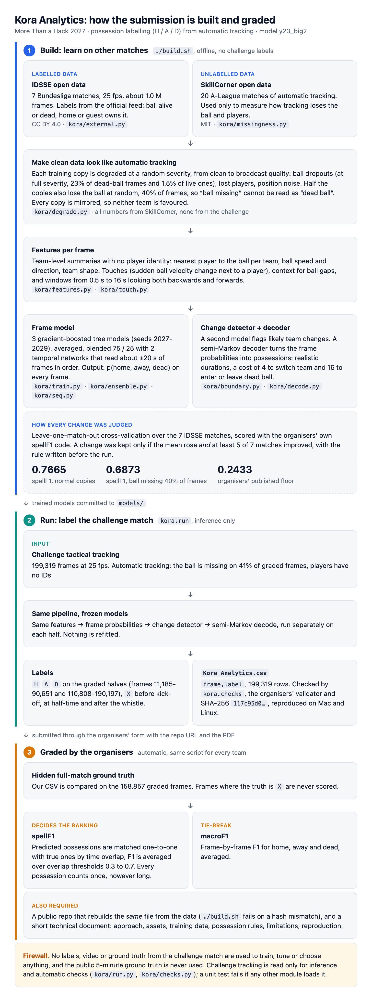

# Kora Analytics: possession from automatic tracking, learned on other matches

## 1. Approach

A frame model learns p(H, A, D | tracking around this frame) on **other matches**: gradient-boosted
trees over window summaries of the tracking, blended with a temporal convolutional network that reads
the frames in order. A decoder then turns those probabilities into a label path with realistic
possessions.
Nothing in the pipeline is fitted to, tuned on, or selected with labels from the challenge match.
Figure 1, at the end of this document, shows the whole pipeline on one page.

Why learned rather than hand rules: every hand rule has a threshold, and with no labels on this
match the only honest way to set thresholds is on other matches where the answer is known. Once that
is the protocol, a model that learns the thresholds jointly from about a million labelled frames
does it better than a person picking them one at a time.

Every change was scored the same way before it was kept: nested leave-one-match-out cross-validation
over the seven training matches, scored with the challenge's own `possession_metrics.py` (spellF1,
vendored under its MIT licence), compared match by match with the current baseline. The decision
rule was written in `RESEARCH.md` before each run: keep a change only if mean spellF1 rises and at
least 5 of the 7 matches improve. Two rounds used a registered variant of it: mixed training (J6) was
kept for its heavy-gap gain (+0.0881, 7/7) at a cost of 0.0017 on normal copies, and the last decoding
round (Y26, Y27) was judged on heavy-gap copies first.

## 2. Assets: used and dropped

| asset | status | how / why |
|---|---|---|
| tactical tracking of the provided game | **used, inference only** | the only input to `kora/run.py` |
| broadcast tracking, homography, video | not used | a video ball detector was considered for ball gaps; detection, licensing of pretrained weights and synchronisation cost more than the time left |
| Smart Tagging | not used | tag agreement cannot validate a gain without labels; deferred (`RESEARCH.md` S2) |
| IDSSE open data | **used** | all training labels (section 3) |
| SkillCorner open data | **used** | measurements of how automatic tracking loses the ball and players (section 4); no labels used |
| Metrica sample data | dropped | two matched comparisons gave +0.54 and −0.61 points of gap-frame accuracy, and the data has no standard licence |
| player-only model fused in ball gaps | dropped | the main model was already as accurate inside gaps (85.8% vs 84.4% team accuracy) |
| PathCRF (players-only event detection) | considered, not run | requires adapting its supervision to our team-possession task; the team judged seven-fold training infeasible before the deadline (`RESEARCH.md` V10) |
| wider decoder grid, boundary bonus on team changes only | dropped | on B0: 0.7143 and 0.7146 vs 0.7147 (better on 0/7 and 1/7 matches). The wider grid chose B0's settings in 6 of 7 folds and the bonus change altered 51 frames, and neither candidate passed the registered keep rule on B0 (`RESEARCH.md` V5, V6) |
| separate costs for entering and leaving dead ball | dropped before testing | stoppages and restarts alternate within a half: with the total cost, endpoint states and same-state continuation penalties fixed, changing the split between the two cannot change the preferred internal boundaries (`RESEARCH.md` V6) |
| stage-2 refiner, wider decoder grid, dwell features, full possession balancing | dropped | on R2 (0.7528): 0.7415 (0/7), 0.7547 (3/7), 0.7492 (3/7), 0.7500 (2/7) (`RESEARCH.md` Y7, Y8) |
| priority for team-change detector targets | dropped | 0.7574 on R2 but 4/7 with two ties; a second round on the mixed model was registered but not run (`RESEARCH.md` V7) |
| cuts at detector peaks, mirror averaging, weak-touch peaks | dropped | on the mixed model (0.7511): 0.7549 (4/7), 0.7553 (4/7), 0.7497 (3/7) (`RESEARCH.md` Y10-Y12) |
| touch-event model relabelling short spells | dropped | its gate passed (it finds 80 of 470 swallowed possessions where the detector finds 62), but relabelling scored 0.7521 vs 0.7511, 1/7 (`RESEARCH.md` Y13, Y14) |
| filling short ball gaps | dropped | 0.7576 vs 0.7511 (4/7) alone; 0.7582 vs 0.7566 (3/7) on the three-seed tree ensemble (Y16), so most of its gain was seed noise (`RESEARCH.md` Y15, Y18) |
| other tree settings: LightGBM at the same settings, feature bagging, deeper trees, 1000 trees | not used | screened against the single-seed base (0.7516): 0.7488, 0.7521 (3/7), deeper stopped for compute. 1000 trees passed as a three-seed ensemble (0.7595 vs 0.7566, 5/7) but gained less than the temporal network; combined with the network they scored 0.7634 against 0.7665 (3/7), so the combination was dropped (`RESEARCH.md` Y20, Y24) |
| a smaller temporal network from one seed | dropped | 0.7673 (+0.0107, 7/7) with seed 2027 but 0.7577 (+0.0011, 4/7) with seed 2028: most of the gain was one seed's luck (`RESEARCH.md` Y22) |
| SkillCorner possession events as labels (20 more test matches) | dropped by a pre-registered gate | labels derived from its player-possession events are coarser than the possession scored here: 136 possessions per 45 minutes against IDSSE's 206, median 5.7 s against 3.8 s. As a test set they would reward missing short possessions (`RESEARCH.md` Y19) |
| heavy-gap decoder choice, dearer dead-ball switch where the ball is missing, cuts, more network weight where the ball is missing, snapping team changes to the detector | dropped | decode-only, judged on heavy-gap copies first: 0.6822, 0.6817, 0.6815, 0.6831 (5/7, then −0.0037 on a second seed), 0.6829 (1/7), against 0.6860 for what ships (`RESEARCH.md` Y26, Y27) |
| synthetic Google Research Football games (Radke and Tilbury, AAMAS 2025, `Dtradke/grf_tracking_data` on GitHub; the repository names no licence), 150 games as extra tree training data | dropped | screened against the single-seed base: 0.7469 vs 0.7516 (3/7) on normal copies and 0.6564 vs 0.6643 (2/7) on heavy-gap copies; simulated play hurt most where the ball is missing (`RESEARCH.md` Y28) |
| four degraded training copies per match instead of two, three of them with random ball gaps | dropped | one tree model gained under heavy gaps (0.6607 to 0.6793, 7/7), but on the submitted ensemble it moved heavy gaps from 0.6822 to 0.6824 (3/7) and normal copies from 0.7665 to 0.7618 (1/7): the three-seed average and the network already remove those errors (`RESEARCH.md` Y29) |

## 3. Training data (all from other games)

| dataset | what | labels | who labelled | size |
|---|---|---|---|---|
| IDSSE open data (Bassek, Weber, Rein, Memmert, *Scientific Data* 2025, doi:10.1038/s41597-025-04505-y), CC BY 4.0 | 7 full Bundesliga / 2. Bundesliga 2022/23 matches, DFL positional data, 25 Hz | per-frame `BallStatus` (alive/dead) and `BallPossession` (home/guest) from the official tracking feed | DFL / Sportec Solutions, official match data | about 1.0 M labelled frames |
| SkillCorner open data (`SkillCorner/opendata` on GitHub, commit 4340d27), MIT licence, credit SkillCorner | 20 A-League 2024/25 matches of automatic broadcast tracking, 10 fps, with `is_detected` for the ball and every player | none used as training labels; only its detection gaps are measured (section 4) | n/a | about 1.2 M frames |

These labels are the same kind the challenge ground truth is derived from: corrected tracking that
marks the ball dead or names the team that owns it. No event data, possession data or annotation
of the challenge match is used anywhere. Simulated Google Research Football games were tried as
extra training data and dropped (section 2), so the submitted models are trained on IDSSE only.

## 4. Making the training data look like automatic tracking (external measurements only)

The training tracking is corrected and complete; the challenge tracking is automatic and loses the
ball and players. A model trained on clean data leans on signals that are missing at test time, so
each training copy is degraded at random (domain randomisation). Every number in the degradation
comes from **external data** (`kora/missingness.py` -> `models/degrade_external.json`):

| process | measured on | how |
|---|---|---|
| P(ball missing \| dead), P(ball missing \| alive) | SkillCorner | frames where the camera shows a detected player; a frame with no possession owner stands in for a stoppage: 0.23 and 0.015 |
| live ball-gap lengths | SkillCorner | gaps flanked by a known possession on both sides |
| blackout offsets inside a stoppage | SkillCorner | ball gaps inside runs with no possession owner |
| player visible / lost stretches, close-ups | SkillCorner | `is_detected` per player; stoppages where fewer than half the usual players are detected |
| positional noise | SkillCorner vs IDSSE | excess variance of the second difference of positions |

Two measurement rules were candidates: every frame of the external stream (cuts and replays
included; ball missing on 40% of frames) and only frames where the camera shows a detected player
(5.7%). The organisers' documentation reports the challenge ball missing on 41% of graded frames, and
we knew that when the first rule was proposed, so the choice was made by a check pre-registered before
it ran and using external data only: degrade the seven IDSSE matches with each candidate and train a
classifier to tell their missingness features from real SkillCorner tracking. The camera-on rule was
harder to tell apart (AUC 0.87 vs 0.96 over 7 folds) and is used. No parameter was fitted to the challenge.

SkillCorner is broadcast tracking, so its missingness is heavier than a fixed tactical camera's. Each
training copy therefore draws a severity s ~ U(0, 1) that scales every process, from clean IDSSE
(s = 0) to SkillCorner broadcast (s = 1). The model sees the whole range and is tuned on none of
the challenge tracking.

**Ball gaps that carry no label information (mixed training, `RESEARCH.md` J6).** In the camera-on
estimate the ball goes missing mostly during stoppages, so a model can learn "ball missing means dead
ball". Half the training copies (the odd ones) therefore lose the ball at random instead: gaps with
SkillCorner's every-frame lengths, placed uniformly in each half without looking at the labels, until
SkillCorner's every-frame missing share (40%) is spent. A second set of evaluation copies masked the
same way (the "heavy-gap" copies) is scored for most candidates since. Under heavy gaps a model
trained without this loses 0.180 spellF1 (0.7528 to 0.5726); mixed training recovers about half of it
on every match (0.6607, 7/7) at a cost of 0.0017 on the normal copies.

## 5. Features (permutation-invariant, orientation-canonical, missing-aware)

Track slots carry no identity, so every feature is a team-level aggregate: nearest and second-nearest
player to the ball per team, counts within 2 m and 5 m, ball-to-player relative velocity (a carried
ball moves with its player), ball speed, turn and out-of-pitch distance, team centroids, spread,
length, forward velocity, running share, median player speed. Within each half the home side is
rotated to attack +x. Ball blackouts get explicit context: seconds since and until the ball is seen,
the ball and nearest-team state at either end of the gap, and which team was last and next within
1.5 m of it. Everything is also summarised over centred, past-only and future-only windows from
0.5 s to 16 s (the submission is offline, so the model may look both ways). Training copies are also
mirrored (teams swapped, pitch rotated) so the model has no home/away bias.

**Touches** (`kora/touch.py`). Most possessions we missed were short ones, and a short possession
starts with a touch: a sudden change of ball velocity next to a player. We add the ball's velocity
change and direction change over ±2 frames, a per-team touch strength (velocity change × exp(−distance
of that team's nearest player / 1 m)), touch events, the team and time of the last and next touch,
touch counts per team over 1-4 s, and the length of the current same-team touch chain (the "more than
two consecutive passes" proxy). The event threshold, 2.7 m/s, is the 95th percentile of the ball's
velocity change in free flight during IDSSE live play, set without possession labels.

## 6. Model and decoding

- **Classifier:** gradient-boosted trees (scikit-learn `HistGradientBoostingClassifier`, 3 classes).
  Frames are weighted so that every possession counts about equally, as it does in spellF1, instead of
  long possessions dominating (weight (1 − λ) + λ · mean length / possession length, λ = 0.5).
- **Three members, averaged (`RESEARCH.md` Y16).** The submission averages the probabilities of three
  classifiers whose degraded training copies and fits use seeds 2027, 2028 and 2029. One seed alone
  moves held-out spellF1 by up to ~0.018, more than most candidate changes, so the average is both a
  better model and a steadier baseline for later comparisons.
- **Temporal network (`kora/seq.py`, `RESEARCH.md` Y22, Y23).** The trees see each frame through window
  averages, which blur the order of events, and a short possession is an ordered pattern: a touch by
  one team between touches by the other. A non-causal temporal convolutional network reads the same
  frame features in order: 9 residual blocks of dilated 1-D convolutions (kernel 3, dilations 1 to 256,
  96 channels), so each frame sees ±511 frames (about 20 s). It is trained on the same degraded copies
  and balance weights as the trees (PyTorch, 3,000 steps on 3,072-frame windows that never cross a
  half). Two networks, seeds 2027 and 2028, are averaged, and stage 1 is 0.75 × trees + 0.25 × network.
  In pre-registered screens the weight 0.25 beat 0.5, and the network alone scored 0.7375, below the
  trees: it adds to them rather than replacing them.
- **Change detector:** a second model predicts, from windows of the classifier's out-of-fold
  probabilities and a few raw signals, whether a team change, a live/dead change or no change is
  within 0.2 s. Only its team-change probability is used.
- **Decoder:** a semi-Markov Viterbi over H, A, D on 3-frame blocks (0.12 s). Each segment scores its
  summed log-posterior, a duration prior learned on the training matches, and a bonus of
  β · log(max(p, 10⁻⁴) / rate) at the start of every live segment, where p is the highest
  team-change probability in the segment's first block and rate is the share of training frames
  whose detector target is a team change. Switching costs apply to a change of
  possession and to entering or leaving dead ball. A plain HMM Viterbi is the alternative. Which
  decoder and which costs are used is chosen inside the training folds only: for the submitted
  model, nested cross-validation picks the semi-Markov decoder on 3 of the 7 held-out matches. The
  submission build applies the same kind of rule once, over all seven matches (`kora/boundary.py`:
  the semi-Markov decoder only if it wins on at least 5 of 7). For the Y16 submission it did not; for
  the submitted model it does (0.7675 against 0.7640 for the plain decoder), so the submission uses the
  semi-Markov decoder (switching costs 4 for a change of possession and 16 for dead ball).

## 7. Possession rules implemented

The rules are learned from the IDSSE labels, which come from the same kind of corrected tracking as
the challenge ground truth. The decoder's switching costs and duration prior make them likely, but
they are learned tendencies, not hard constraints:

- **Dead ball is always `D`.** We never assign a dead ball to a team, and a restart begins a new
  possession for whoever plays the ball.
- **Loose and contested balls stay with the last team in possession.** That is how the training
  labels mark them, and the switching cost makes a lone deflection cheaper to ignore than to report
  as two changes of possession.
- **Controlled possession.** A change is reported when the evidence for the other team over the
  following frames outweighs the switching cost: a player keeping the ball, or a chain of same-team
  touches. The costs and the duration prior were learned on the training matches.
- **`X`** is written only for frames outside the two graded periods; every graded frame gets H, A or D.

## 8. Results (nested cross-validation on the seven training matches)

| variant | spellF1 | heavy ball gaps | vs previous row |
|---|---:|---:|---|
| B0: compliant baseline | 0.7147 ± 0.0234 | | |
| R1: + touch features | 0.7432 ± 0.0325 | | +0.0284, 6/7 better |
| R2: + balanced weights | 0.7528 ± 0.0279 | 0.5726 | +0.0097, 6/7 |
| J6: + mixed training | 0.7511 ± 0.0270 | 0.6607 | −0.0017; heavy gaps +0.0881, 7/7 |
| Y16: + three seed members (submitted 6 Nov) | 0.7566 ± 0.0300 | 0.6783 | +0.0055, 5/7; heavy gaps +0.0176, 6/7 |
| **Y23: + temporal network, two seeds (submitted)** | **0.7665 ± 0.0293** | **0.6822** | **+0.0099, 7/7; heavy gaps +0.0039, 4/7** |

Each held-out match is excluded from the classifier, the detector, the duration prior and decoder
selection, and scored once. "Heavy ball gaps" scores the same models on evaluation copies with
label-free random ball gaps at 40% (section 4); since J6 a candidate may not lose more than 0.01
there. The network was kept only after its second seed passed too: one larger network scored +0.0103
(seed 2027) and +0.0069 (seed 2028) against Y16, and the submission averages the two. With the plain
decoder on every fold it scores 0.7638, and with the semi-Markov decoder on
every fold, as submitted, 0.7681. The heavy-gap column re-chooses the decoder and its costs on
heavy-gap copies (0.6809 plain, 0.6836 semi-Markov). Keeping the choices made on normal copies, as the
build does, scores higher under heavy gaps: 0.6860 with each fold's own choice and 0.6873 with the
semi-Markov decoder on every fold, as submitted (`RESEARCH.md` Y26). Recall of true
possessions under 1 s rose from 0.21 (B0) to 0.32, and for 1-2 s from 0.44 to 0.57; spellF1 at IoU
0.3 / 0.5 / 0.7 is 0.840 / 0.776 / 0.677 (Y16: 0.833 / 0.765 / 0.668).

## 9. Limitations

- **Short possessions are still the main error.** On the mixed model's held-out predictions
  (`kora/ceiling.py`), fixing the swallowed possessions perfectly (true possessions covered on less than
  half their frames) would raise spellF1 from 0.751 to 0.918, fixing every possession under 2 s to
  0.861, but snapping every boundary within 0.5 s of a predicted change only to 0.766. Inside the
  swallowed possessions the ball is visible 99% of the time, yet the frame classifier prefers the true
  team on at least half their frames in only 16% of them: its evidence there is no stronger than its
  noise. That is why decoder changes moved the score by less than 0.005 (section 2).
- **Seed noise is as large as most changes.** One seed alone moves held-out spellF1 by up to ~0.018,
  so a single-seed comparison can pass or fail the 5-of-7 rule by chance. The three-seed tree
  average (Y16) reduces this for later comparisons: the short ball-gap fill, +0.0065 on one seed, shrank
  to +0.0016 on the average (`RESEARCH.md` Y15, Y18). The network showed the same: a small network's
  +0.0107 on one seed was +0.0011 on another (Y22), so the submitted network is a two-seed average
  whose seeds each passed on their own.
- **The network's rebuild depends on hardware.** It is fitted on an Apple GPU (two fits of the smaller
  network with the same seed gave identical predictions) and run on the CPU, so `kora.run` reproduces
  the submission from the committed models on any machine. A from-scratch `build.sh` elsewhere refits
  it, which is much slower without a GPU and may not match the committed hash bit for bit.
- **The validation sees few ball gaps.** Normal evaluation copies are degraded with the camera-on
  estimate (3.9% of the ball missing, `RESEARCH.md` V4), while the challenge ball is missing on 41% of graded
  frames. Most candidates since J6 are therefore also scored on heavy-gap copies (40% missing at
  random, section 8). Degrading the whole evaluation copy, players included, at full SkillCorner
  broadcast severity scores 0.630 for the mixed model (`RESEARCH.md` V8, report only).
- **Where the errors are (the submitted `y23_big2`, `RESEARCH.md` V1–V4, V9).** It predicts 11.5% too
  few possessions (2,710 against 3,061). Of the 826 true possessions missed at IoU 0.5, 382 (46%) are
  covered on at least half their frames by opposite-team predictions, most of them shorter than 2 s,
  392 (47%) by same-team predictions despite failing IoU matching, 48 (6%) have a wrong-team prediction
  with IoU ≥ 0.5, and 4 are covered by dead ball. These are ordered diagnostic categories, not
  established causes. Team changes are recovered less often than restarts (recall 0.65 against 0.96
  within 1 s), and 165 of the 171 missed stoppages have a predicted stoppage within 1 s with the wrong
  team just before it.
- **Boundary targets.** The change detector's training targets mark ±5 frames around each change,
  and live/dead targets overwrite overlapping team-change target frames. A label audit found this
  partly affects 41 of 2,351 team-change windows (1.7%), mostly just before stoppages, and erases
  none completely (`RESEARCH.md` V7). Giving team changes priority (`v7_ha_priority`) moved
  nested spellF1 from 0.7528 to 0.7574 but improved only 4 of 7 matches (two unchanged), so it was
  not kept.
- **Seven training matches, one league.** All labels are German top-two-division matches; the
  challenge match may differ in style and camera.
- **With more time:** a video ball detector for the gaps (gated on licensed weights and external
  calibration) and more labelled open matches. The largest open set we found, PFF FC's 2022 World Cup
  data, is excluded: its Terms of Use forbid training machine-learning models on it. Decoding changes
  are exhausted: the last round (choosing the decoder on heavy-gap copies, dearer dead-ball switches
  where the ball is missing, snapping changes to the detector) found nothing (`RESEARCH.md` Y26, Y27).
  Simulated games and extra degraded copies did not help either (Y28, Y29); the
  one untried variant is retraining the temporal network on the extra copies, not only the trees.

## 10. Reproduction

```bash
./build.sh                                     # venv, download, train, decode, check; fails on a hash mismatch
.venv/bin/python -m kora.run --out "Kora Analytics.csv"   # submission from the committed models
shasum -a 256 -c models/submission.sha256                 # must print OK: the same file we submitted
.venv/bin/python -m kora.nested --variant mixed           # single-seed base (about 1-2 h; folds are cached)
.venv/bin/python -m kora.nested --variant y16_seeds       # the three-member tree ensemble (Y16)
.venv/bin/python -m kora.nested --variant y23_big2        # the submitted model: Y16 + the network (GPU if present)
.venv/bin/python -m kora.compare y16_seeds y23_big2       # paired comparison, with the keep rule
```

The submitted file is built from the git tag `submission`. Match data is gated and never committed; `data/` and every derived array are gitignored.

## 11. Compliance with the organisers' rules (clarification of 3 November 2026)

- **No labels, video or ground truth of the provided game** are used to train, fit, calibrate, tune or
  select anything. The public 5-minute ground truth is not used at all; the organisers' validator
  checks the file format.
- **Rebased on 3 Nov.** Before the clarification, the degradation ranges were set from unlabelled
  statistics of the challenge tracking (ball-missing rate by player speed, close-up frequency,
  positional jitter), and a domain classifier on that tracking informed the design rule that the
  model must not see team-identity features (goalkeeper depth). Under the clarified rules we
  re-derived every degradation value from external data (section 4) and re-ran the evaluation
  (baseline B0, `RESEARCH.md` Y5). The no-team-identity rule stays as a design principle: track slots
  carry no identity and every training copy is mirrored, so team identity must not matter.
- **AI assistance.** Code was written with AI coding assistants (Claude, and OpenAI's Codex for parts
  of the error metrics and decoder variants, under the same restrictions). On 30 October, before the
  clarification, raw rows of the provided tracking files and one frame of the broadcast video were
  displayed to Claude while inspecting the data formats. Since 3 November both assistants have worked
  only on code and on external-data results; challenge-side checks are run and read by a team member, and for our own
  submission file they read only the validator verdict, row count and hash. One exception: on 9 November
  Claude displayed the first 20 rows of our own submission file (all X, before kick-off) while looking
  for registration instructions; no score or ground truth was involved.
- **Challenge data is read only for inference and automatic checks** (`kora/run.py`, `kora/checks.py`;
  `kora/profile.py` and `kora/shift.py` are diagnostics). A unit test (`tests/test_compliance.py`)
  fails if any other module imports the challenge loaders.


